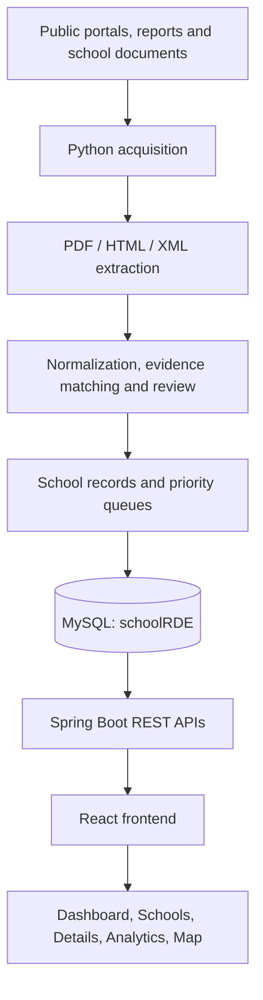

# 🏫 School Risk Discovery Engine (SRDE)

> Bringing scattered school infrastructure records, inspection information, and public evidence together to support explainable school-level inspection prioritization.

## Overview

**School Risk Discovery Engine (SRDE)** is a full-stack academic project developed for **CS699 Software Lab**. It helps organize school details, reported infrastructure issues, inspection history, supporting documents, and historical priority assessments in one place.

The system collects and processes accessible public data, stores school-related records in **MySQL**, exposes them through a **Spring Boot REST API**, and presents the information in a **React** dashboard. Users can browse schools, examine the evidence behind reported concerns, and identify schools that may warrant further inspection.

**The priority score is a decision-support indicator—not a verified safety rating or a declaration that a school is currently unsafe.**

## Key Features

- **School directory and search** — Browse schools and explore available identifiers, district information, and priority assessments; the frontend includes search and priority filters.
- **Top 50 priority schools** — Display schools ranked by recorded priority scores, when assessment data is available.
- **School details and evidence** — Inspect reported issues, supporting sources, documents, events, inspections, and priority history.
- **Dashboard and analytics** — View school counts, issue summaries, priority distributions, and charts.
- **Interactive school map** — Explore schools with valid coordinates using Leaflet and OpenStreetMap; records without usable coordinates are excluded from markers.
- **School activity timeline** — Review dated school events, inspections, issues, and assessment records.
- **Public document collection** — Discover and download relevant infrastructure documents from accessible sources, including Gyan Sankalp.
- **Data extraction and quality review** — Process PDF, HTML, and XML content, normalize school information, flag uncertain matches, and preserve supporting evidence.
- **Explainable prioritization** — Build school inspection queues with supporting evidence and review information rather than relying on an unexplained prediction.

## Infrastructure and Evidence Categories

The database supports infrastructure and service-related issue categories such as:

| Area | Example issue categories |
| --- | --- |
| Buildings and classrooms | Building condition, classrooms, roofs, boundary walls |
| Essential facilities | Drinking water, electricity, toilets |
| Access and services | Road access, mid-day meal availability, quality, and management |
| Inspection and repair | Inspections, issue status, repair projects, tenders, supporting documents |

Reported issue states include **ACTIVE**, **UNDER_REPAIR**, **RESOLVED**, **VERIFIED**, and **UNKNOWN**. These are database record states and depend on the accuracy and freshness of the underlying evidence.

## Technology Stack

| Component | Technology | Purpose |
| --- | --- | --- |
| Data processing | Python | Data collection, parsing, matching, validation, and prioritization |
| Web acquisition | Requests, Beautiful Soup | Discover public documents and extract links or article content |
| Document parsing | pypdf, defusedxml | Extract PDF text and process structured document formats |
| Backend | Java 21, Spring Boot, Spring Data JPA | Business logic and REST APIs |
| API security | Spring Security, JWT | Token-based API access |
| Database | MySQL | Store schools, issues, inspections, documents, and assessments |
| Frontend | React, JavaScript, CSS | User-facing school dashboard and pages |
| Visualization | Recharts, React Leaflet, OpenStreetMap | Charts and geographic exploration |
| Development | Maven, Git, GitHub | Backend dependency management and version control |

## System Architecture



The three principal workstreams are **Data Preparation & Intelligence**, **Database & Backend APIs**, and **Frontend & Visualization**.

## Project Structure

The following tree reflects the **uploaded repository ZIP**. Representative files are shown for directories with many similarly structured Java classes.

```text
school-risk-discovery-engine-main/
│
├── README.md                              # Project documentation
│
├── backend/                               # Java / Spring Boot backend
│   ├── pom.xml                            # Maven dependencies; Java 21
│   ├── resources/
│   │   ├── application.properties          # Server, MySQL and JWT configuration
│   │   └── error.properties                # API error messages
│   └── schoolservice/
│       ├── SchoolServiceApplication.java  # Spring Boot application class
│       ├── config/                        # JWT filter and Spring Security
│       ├── controller/                    # School, issue, inspection and other APIs
│       │   ├── SchoolController.java
│       │   ├── IssueController.java
│       │   ├── InspectionController.java
│       │   ├── PrioritySnapshotController.java
│       │   └── JwtController.java
│       ├── dao/
│       │   ├── bussiness/                 # DAO interfaces and implementations
│       │   └── repository/                # Spring Data repositories
│       ├── dto/                           # Request and response objects
│       ├── entity/                        # Database entities
│       ├── exception/                     # Exception handling
│       ├── service/                       # Application business logic
│       └── util/                          # Supporting utilities
│
├── database/
│   └── schoolRDE.sql                      # MySQL schema and sample data
│
├── data_pipeline/                         # Python data and intelligence pipeline
│   ├── README.md                          # Pipeline-specific notes
│   ├── __main__.py                        # Pipeline module entry point
│   ├── acquisition/
│   │   ├── gyan_sankalp.py                # Discover and download infrastructure PDFs
│   │   ├── pdf.py                         # PDF acquisition utility
│   │   └── public_news.py                 # Public news and report collection
│   ├── extraction/
│   │   ├── document_extractor.py          # Generalized document processing
│   │   ├── pdf_parser.py                  # PDF parser
│   │   ├── pdf_text.py                    # Page-level PDF text extraction
│   │   ├── html_parser.py                 # HTML parser
│   │   ├── xml_parser.py                  # XML parser
│   │   ├── repair_rows.py                 # Structured repair-list extraction
│   │   └── school_records.py              # School and evidence field extraction
│   ├── evidence/
│   │   ├── public_reports.py              # Public-report evidence linking
│   │   ├── tender_links.py                # Tender evidence matching
│   │   └── timeline.py                    # Evidence timeline construction
│   ├── matching/
│   │   └── school.py                      # School record matching
│   ├── normalization/
│   │   ├── school_name.py                 # School-name normalization
│   │   └── udise_code.py                  # Identifier validation
│   ├── prioritization/
│   │   ├── ranking.py                     # Evidence-based ranking
│   │   ├── report_queue.py                # Report-driven priority queue
│   │   └── unified_queue.py               # Combined inspection queue
│   ├── quality/
│   │   └── repair_audit.py                # Extraction quality audit
│   ├── integration/
│   │   ├── priority_schema.sql            # Report-priority table schema
│   │   ├── priority_store.py              # Priority import to MySQL
│   │   └── school_data_store.py           # School and evidence database sync
│   ├── models/                            # Document and retrieval data models
│   └── run_public_reports.py              # Public-report pipeline launcher
│
├── frontend/                               # React frontend source
│   ├── public/                            # Images and icons
│   │   ├── dashboard.png
│   │   ├── analytics.png
│   │   └── map.png
│   └── src/
│       ├── App.jsx                       # Application page selection and API loading
│       ├── App.css
│       ├── components/
│       │   ├── Navbar.jsx
│       │   ├── Sidebar.jsx
│       │   ├── Loading.jsx
│       │   └── ErrorMessage.jsx
│       ├── pages/
│       │   ├── Dashboard.jsx
│       │   ├── Schools.jsx
│       │   ├── SchoolDetails.jsx
│       │   ├── Analytics.jsx
│       │   ├── Map.jsx
│       │   └── BackendSchoolTest.jsx
│       ├── services/
│       │   └── api.js                    # Backend API client
│       ├── data/                         # Demonstration school and evidence data
│       └── utils/
│           └── normalizeSchool.js        # Frontend school-data normalization
│
└── docs/                                   # Technical documentation
    ├── api-contract.md                    # API routes and contracts
    ├── database-schema.md                 # Tables and relationships
    ├── data-model.md                      # Data model
    ├── data-source-requirements.md        # Data source requirements
    └── priority-model.md                  # Evidence and priority model
```

## Codebase Guide

### 1. Data Acquisition and Processing

`data_pipeline/acquisition/gyan_sankalp.py` discovers qualifying public infrastructure PDFs and keeps download metadata for incremental collection. `document_extractor.py` reads acquisition manifests or explicitly supplied documents, dispatches PDF/HTML/XML parsing, and generates structured school and evidence records. The normalization, matching, and quality modules help separate usable information from records needing review.

### 2. Evidence and Prioritization

The `evidence/` modules connect public reports and tenders to schools where possible and construct supporting timelines. The `prioritization/` modules create explainable priority queues. A higher priority reflects the **available recorded evidence** and does not establish a current physical safety condition.

### 3. Database and Backend

`database/schoolRDE.sql` creates the MySQL `schoolRDE` schema. It includes tables for schools, issues, inspections, events, projects, tenders, sources, documents, and historical priority snapshots. The backend follows a **Controller → Service → DAO → Repository** design, with data transfer objects, entity models, error handling, and JWT-based authentication.

### 4. Frontend

`frontend/src/App.jsx` loads school data from the backend and switches between the Dashboard, Schools, School Details, Map, and Analytics pages. Components in `frontend/src/components/` provide common navigation and loading/error states. `frontend/src/services/api.js` contains API request helpers.

## Getting Started

### Prerequisites

- **Git** to clone the repository
- **Python 3.10+** and `pip` for the data pipeline
- **MySQL** for the database
- **Java 21** and **Maven** for the backend (as specified by `backend/pom.xml`)
- **Node.js** and **npm** for the React frontend **after restoring its missing project manifests** (see *Snapshot Notes*)

### 1. Clone the Repository

```bash
git clone https://github.com/Muradaalam/school-risk-discovery-engine.git
cd school-risk-discovery-engine
```

### 2. Set Up the MySQL Database

Start a local MySQL server. The supplied SQL script creates `schoolRDE`, its tables, and sample records:

```bash
mysql -u root -p < database/schoolRDE.sql
```

Run the script against a new database server or review it first if `schoolRDE` already exists, since the script includes `CREATE DATABASE schoolRDE` and sample inserts.

Configure your own local database credentials for the backend in `backend/resources/application.properties`. **Do not reuse or publish the example credentials present in the uploaded snapshot.** The data-pipeline database import uses `SRDE_MYSQL_USER`, `SRDE_MYSQL_PASSWORD`, and optional `SRDE_MYSQL_HOST`, `SRDE_MYSQL_PORT`, and `SRDE_MYSQL_DATABASE` environment variables.

### 3. Set Up the Python Data Pipeline

From the repository root:

```bash
python3 -m venv .venv
source .venv/bin/activate
pip install requests beautifulsoup4 pypdf defusedxml mysql-connector-python
```

The uploaded ZIP does not contain a root `requirements.txt`; the command above lists the external packages imported by the included pipeline. Additional dependencies may be needed for other environments or future modules.

**Collect public Gyan Sankalp PDFs:**

```bash
python3 -m data_pipeline.acquisition.gyan_sankalp --limit 5
```

**Extract school records and evidence from the download manifest:**

```bash
python3 -m data_pipeline.extraction.document_extractor \
  --manifest data_pipeline/raw/gyan_sankalp/acquired_documents.jsonl \
  --output-dir data_pipeline/processed/generalized
```

**Build the unified inspection queue (after preparing the required report CSV and extracted records):**

```bash
python3 -m data_pipeline.prioritization.unified_queue \
  --reports data_pipeline/raw/report_school_priorities.csv \
  --schools data_pipeline/processed/generalized/school_records.jsonl
```

The report-priority CSV is a separate prerequisite; it is **not included in the uploaded ZIP**. See `docs/priority-model.md` for the prioritization model and `data_pipeline/integration/priority_store.py` for importing validated priorities into MySQL.

### 4. Run the Backend

The backend is a Spring Boot Maven project targeting **Java 21**, with its application entry point at `backend/schoolservice/SchoolServiceApplication.java`.

**Important for this ZIP:** the Java classes and `resources/` are not in Maven's standard `src/main/java` and `src/main/resources` directories. Restore the normal Maven layout (or configure the source/resource directories in `pom.xml`) before using the standard run command.

Once the backend layout and local database/security settings are configured:

```bash
cd backend
mvn spring-boot:run
```

The application configuration specifies port **8080**, and the API prefix is `/school-service`. Most API endpoints require a JWT bearer token.

### 5. Run the Frontend

The React source is in `frontend/src/`. Restore the missing frontend project files—particularly **`package.json`**, **`index.html`**, **`vite.config.js`**, and **`src/main.jsx`**—from the complete frontend branch or the original project before attempting to install or start it.

After those files and the dependencies are restored:

```bash
cd frontend
npm install
npm run dev
```

The API helper reads `VITE_API_BASE_URL` or defaults to same-origin requests. Configure the frontend/backend connection and authorization as appropriate for your local setup.

## Usage Guide

1. **Dashboard:** Review the school overview, priority summaries, and reported issue statistics.
2. **Schools Directory:** Browse school records and use search or priority filtering to narrow the list.
3. **School Details:** Open a school to review its available records, inspections, issues, source references, and activity timeline.
4. **Map:** Explore schools with valid latitude/longitude values and inspect geographical priority patterns.
5. **Analytics:** Explore priority and issue distributions using charts.
6. **Data Preparation:** Run the Python acquisition and extraction commands when refreshing the underlying public-evidence dataset.

### Selected API Endpoints

The backend uses `/school-service` as its route prefix.

| Method | Endpoint | Purpose |
| --- | --- | --- |
| `POST` | `/school-service/auth/generateToken` | Request an authentication token |
| `GET` | `/school-service/school/getTop50Schools` | Retrieve the top assessed schools |
| `GET` | `/school-service/school/getAllSchools` | Retrieve paginated school records |
| `GET` | `/school-service/school/getSchool/id?id=...` | Retrieve one school's details |
| `GET` | `/school-service/issue/getIssue/schoolId` | Retrieve issue records by school |
| `GET` | `/school-service/inspection/getInspection/schoolId` | Retrieve inspection records by school |

Additional controllers cover events, projects, tenders, sources, documents, and priority snapshots. See [`docs/api-contract.md`](docs/api-contract.md) and the controller classes for their exact request formats. Some frontend source code references `/school-service/school/search`; verify that route exists in the backend version you deploy.

## Pipeline Outputs

A successful generalized extraction writes the following files under `data_pipeline/processed/generalized/`:

| File | Description |
| --- | --- |
| `documents.jsonl` | Processed document and source metadata |
| `school_records.jsonl` | Extracted school-related records |
| `evidence.jsonl` | Supporting evidence extracted from sources |
| `review.jsonl` | Uncertain identities, parsing problems, and other review items |
| `summary.json` | Extraction statistics |

These are generated outputs and may not be included in a GitHub ZIP archive. School codes in raw public documents should not automatically be treated as verified UDISE codes.

## Limitations

- **Official data availability:** Some government or school-level information requires authentication or is not publicly accessible.
- **Freshness and verification:** Public reports may describe historical issues; repairs may have occurred after publication.
- **Identifier matching:** Inconsistent names or incomplete identifiers can lead to ambiguous school matches that require review.
- **Incomplete geolocation:** Records without reliable coordinates cannot be shown accurately on the map.
- **Decision-support scope:** Inspection priorities represent recorded evidence and should not be interpreted as certified risk assessments.

## Repository Snapshot Notes

The uploaded ZIP includes **backend source, SQL schema, data-pipeline modules, frontend React source, and documentation**. However, it does **not** include the frontend package/build entry files or the standard Maven directory layout needed for an immediately runnable full-stack checkout. This README describes the contents accurately and notes the restoration steps rather than claiming that the ZIP can be started unchanged.

Also, the supplied backend application properties contain development credentials and signing configuration. Replace and rotate those values before publishing or deploying the project; use private environment-specific configuration instead of committing secrets.

## Contributors

| Name | Student ID | Primary Contribution |
| --- | --- | --- |
| **Shahjad Alam** | 26M0747 | React frontend, school views, dashboard, analytics, map, and search integration |
| **Murad Aalam** | 26M0803 | Public data acquisition, document extraction, normalization, evidence processing, and prioritization |
| **Deendayal Prajapat** | 26M0815 | MySQL schema, Spring Boot backend, DAO/repository layers, REST APIs, and authentication |

**Faculty Guide:** Prof. Om P. Damani  
**Course:** CS699 — Software Lab

## Further Documentation

- [`docs/api-contract.md`](docs/api-contract.md) — Backend API contract
- [`docs/database-schema.md`](docs/database-schema.md) — Database entities and relationships
- [`docs/data-model.md`](docs/data-model.md) — Data model
- [`docs/data-source-requirements.md`](docs/data-source-requirements.md) — Collection requirements and constraints
- [`docs/priority-model.md`](docs/priority-model.md) — Inspection priority methodology
- [`data_pipeline/README.md`](data_pipeline/README.md) — Data pipeline responsibilities

---

*SRDE is an academic, evidence-oriented inspection-planning project, not an official government school safety certification system.*
